# TextPath_Te

## 概要

テキストの輪郭をアンカーで編集可能なパスへ変換する、AviUtl2用のプラグイン・スクリプトです。

文字の形状を頂点単位で変形できるほか、筆順データを利用して文字を画（ストローク）ごとに分割し、「ペンで書く」アニメーションの作成やタイムラインへの展開が可能です。

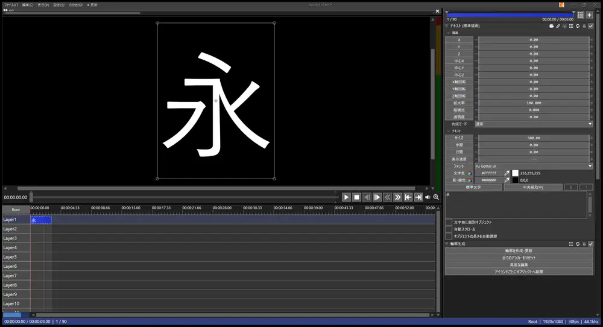

---

## 導入方法

1. [Releases](../../releases) から `TextPath_Te.au2pkg.zip` をダウンロードし、AviUtl2のプレビューウィンドウへドラッグ＆ドロップします。
   - **手動で配置する場合**は、アプリケーションデータフォルダ内に以下のように配置してください（`TextPath_TeStrokes.txt` はプラグインと同じフォルダに配置します）。
     ```text
     Plugin/
     └── TextPath_Te/
         ├── TextPath_Te.aux2
         └── TextPath_TeStrokes.txt
     Script/
     └── TextPath_Te/
         ├── 輪郭パス.anm2
         └── 輪郭パス展開.obj2
     ```
2. AviUtl2を起動します。

### 削除方法

1. 「その他」メニューのパッケージ情報からアンインストールします（手動配置した場合は上記のファイルを削除してください）。
2. ショートカットキーの設定を変更している場合は、アプリケーションデータフォルダ内の `TextPath_Te.ini` も削除します。

---

## 使い方

1. テキストオブジェクトにフィルタ効果「輪郭生成」を追加します。
2. 「輪郭を作成・更新」をクリックすると、フィルタ効果「輪郭パス」が追加され、プレビュー上に輪郭のアンカーとハンドルが表示されます。
3. アンカーをドラッグして形状を編集します。詳細な編集は「高度な編集」ウィンドウで行えます。

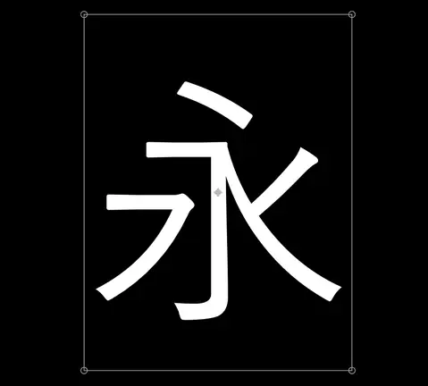

※「輪郭生成」を追加せず、オブジェクトの右クリックメニュー「プラグイン」→「輪郭パス」からでも同様の操作が可能です。

### 輪郭生成のボタン

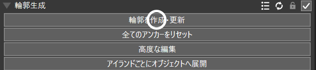

| ボタン | 説明 |
| --- | --- |
| 輪郭を作成・更新 | テキストから輪郭を生成します。フォント・サイズが同じであれば、対応する文字の編集内容を引き継ぎます |
| 全てのアンカーをリセット | 現在の編集内容を破棄し、輪郭を初期状態に再生成します |
| 高度な編集 | 編集用ウィンドウを開きます |
| アイランドごとにオブジェクトへ展開 | アイランド単位でオブジェクトを分割し、タイムライン上に配置します |

### 輪郭パスの設定項目

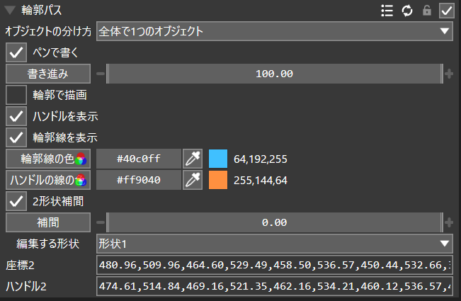

| 項目 | 説明 |
| --- | --- |
| オブジェクトの分け方 | 「全体で1つ」「文字ごと」「アイランドごと」から個別オブジェクトの単位を選択します |
| ペンで書く / 書き進み | 筆順に沿って文字を表示します。「書き進み」が 0 で未描画、100 で全描画となります |
| 輪郭で描画 | 未編集の部分も含め、全体を輪郭から塗り潰して描画します |
| ハンドルを表示 / 輪郭線を表示 | プレビュー上の表示/非表示を切り替えます |
| 輪郭線の色 / ハンドルの線の色 | プレビューに表示されるガイド線の色を設定します |
| 2形状補間 / 補間 / 編集する形状 | 2つの形状間をモーフィング（補間）します |

※サイズ・字間・行間に移動方法を設定した状態で「輪郭を作成・更新」を押すと、開始値と終了値から2つの形状が生成され、同じ移動方法で補間設定が行われます。

2形状補間を使用することで、2つの形状間を滑らかにアニメーションさせることができます。


「オブジェクトの分け方」を「アイランドごと」に設定すると、アイランドごとの個別オブジェクトとしてフィルタ効果が適用されます（以下は「振動」効果を追加した例です）。

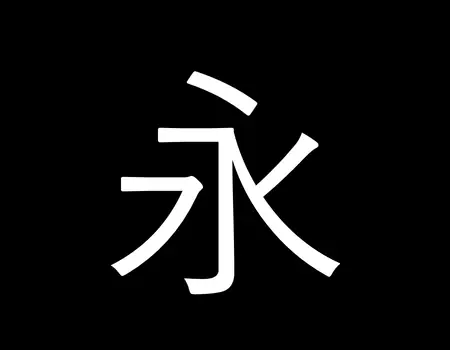

---

## 高度な編集

頂点単位での輪郭編集や、筆順データに基づく画ごとの分解を行うための編集ウィンドウです。

※「アイランド」とは、輪郭の外周とその内部のくり抜き（穴）をまとめた1つの単位を指します。

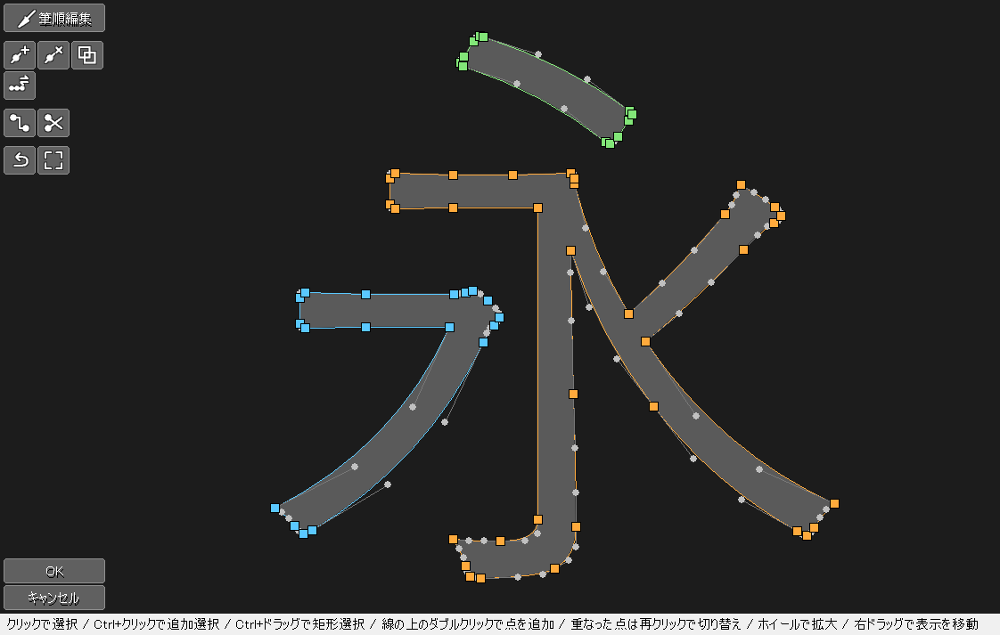

### 輪郭の編集

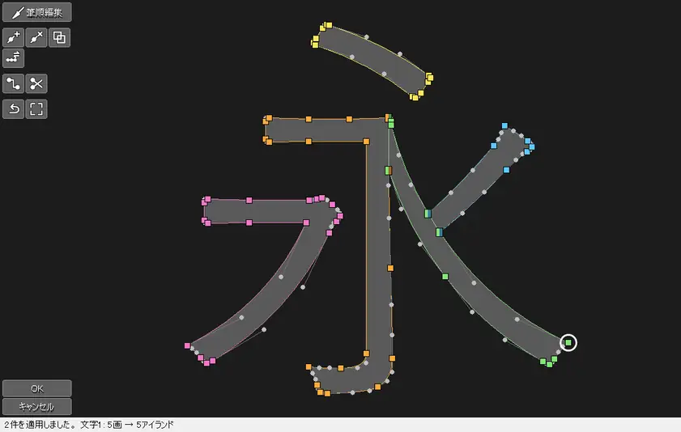

| 操作 | 説明 |
| --- | --- |
| クリック / `Ctrl` + クリック | 点を選択 / 追加選択します。点が重なっている場合は再クリックで切り替えます |
| `Ctrl` + ドラッグ | 矩形範囲でまとめて選択します |
| ドラッグ | 点を移動します。`Shift` キーを押しながらで水平/垂直方向に固定します |
| 線上をダブルクリック | 点を新規追加します |
| ホイール操作 / 右ドラッグ | キャンバスの拡大・縮小 / 移動を行います |
| `F`（つなぎ直す） | 単一輪郭上の2点なら輪郭を2つに分割し、別輪郭の2点なら1つに統合します |
| `S`（カット・交差） | 2点間を切断するか、4点選択時に交差する2線を組み替えます |

### 筆順の編集

`Tab` キー（「筆順編集」）で切り替えます。番号が筆順、矢印が描画方向を示します。頂点のドラッグや「画を追加」ボタンで補正できます。筆順データが存在しない文字は「画を追加」で手動定義が可能です。

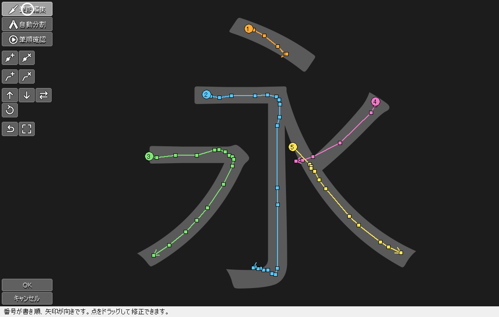

### 自動分割

`P` キー（「自動分割」）を押すと、筆順データに基づいて文字をアイランドへ分割する候補（案）を提示します。適用すると、単一の輪郭だった文字が画ごとのアイランドに分割されます。

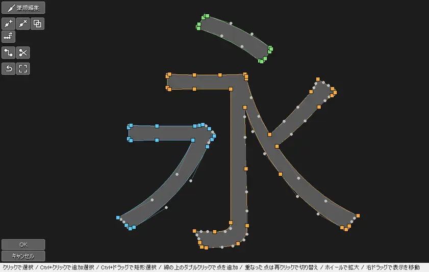

| 操作 | 説明 |
| --- | --- |
| クリック | 提案の採用 / 不採用を切り替えます |
| `Shift` + クリック | 提案の種類（交差 / T字 / 切る線）を変更します。`Q` でオンにすると、`Shift` なしのクリックで変更できます |
| 点のドラッグ | 切断位置を調整します |
| `A` | 提案を手動で追加します（文字をクリックして2点指定後 `Enter` で切る線、4点指定で組み替え） |
| `S` | すべての提案の採用 / 不採用を一括切り替えします |
| `Enter` / 「適用」ボタン | 採用した提案で輪郭を分割します。文字の形が変わってしまう案は適用されず赤色で残ります |

※フォントのデザイン（角丸など）によっては、自動で切断案を生成できない接合部があります。

### 筆順確認

`V` キー（「筆順確認」）を押すと、ウィンドウ内で書き進みアニメーションを再生・確認できます。

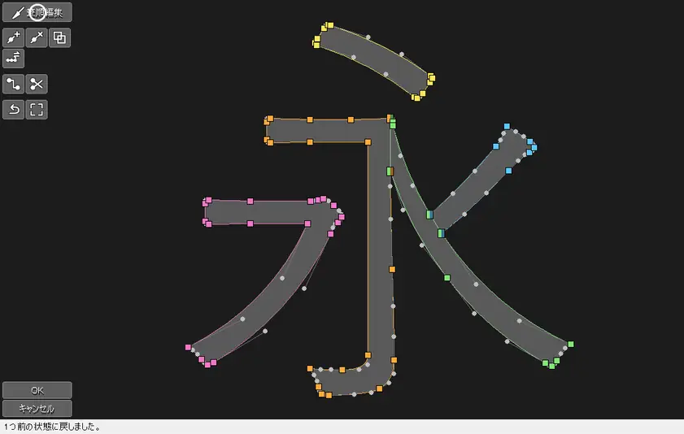

「アニメを作る」を有効にしてOKを押すと、自動的に「ペンで書く」が有効化され、オブジェクトの長さに合わせて「書き進み」が 0 から 100 へ直線移動するように設定されます。


### ショートカットキーの設定

メニューの「設定」→「プラグイン設定」→「輪郭パスの設定」から変更可能です。

---

## アイランドごとのオブジェクトへ展開

アイランドの数だけ個別のオブジェクトを生成し、元のテキストオブジェクトと置き換えます。これにより、画ごとに異なるエフェクトや動きを個別に付与できます。

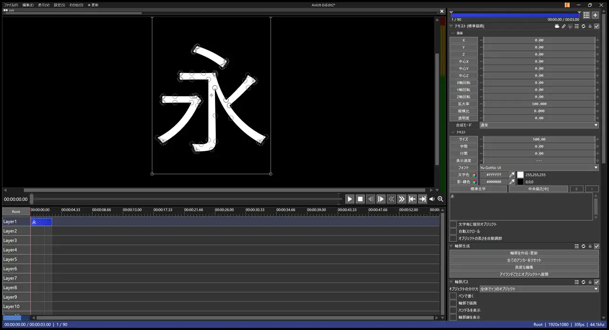

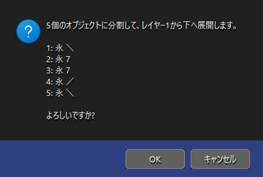

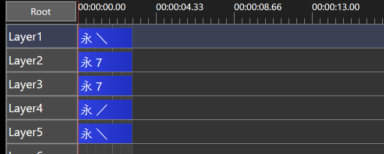

- 展開前の確認画面に、生成されるオブジェクトの個数と名前が表示されます。
- 元のレイヤーから下方へ向かって、筆順の早い順に自動配置されます（配置先に別オブジェクトが存在する場合は展開が中断されます）。
- 生成されるオブジェクト名は「元の文字 概形」となります（例: `口 ー`）。概形は識別用の目安であり、正確な形状と一致しない場合があります。
- 展開後の各オブジェクトはテキストを介さないカスタムオブジェクト「輪郭パス展開」になり、自身のアイランドの輪郭と筆順データのみを保持します。このため「書き進み」はそのアイランドの画だけの進行割合となります。
- 文字色は展開後の「文字色」の項目へ引き継がれます。標準描画の値と、他のフィルタ効果も引き継がれます。
- 「元に戻す（Undo）」1回で展開前の状態に復元可能です。

---

## 既知の制限事項

- 太字・斜体・文字装飾・制御文字・縦書きテキストには対応していません。
- サイズ等の「移動」パラメータの中間点は考慮されません。
- 筆順データが存在しない文字は、「ペンで書く」の適用時にその文字の順番が来たタイミングで一気に描画されます（「画を追加」で筆順を設定することで解消します）。
- 「文字毎に個別オブジェクト」設定時、アンカーは標準描画の回転・拡大率に追従しません（描画自体は正しく行われます）。
- 分割した文字を「アイランドごとに個別オブジェクト」にし、書き進みの途中状態を描画させた場合、「全体で1つ」の設定時とわずかに描画差分が生じることがあります。
- 展開済みのオブジェクトに対しては「輪郭を作成・更新」「全てのアンカーをリセット」「筆順を既定に戻す」は機能しません。フォントやテキストの内容も変更できません。
- 展開後は常に輪郭から塗るので、文字の縁の濃さが展開前とわずかに変わることがあります。サイズ等に移動方法が付いたテキストを展開すると、途中のフレームの位置が1ピクセルほどずれることがあります。
- 輪郭パスより前に置いたフィルタ効果は、展開後は字全体ではなくアイランドごとに掛かります。

---

## 更新履歴

- **v1.1** (2026/11/02): 動作を軽量化(塗り終えた画像の再利用、分割した文字の塗りの高速化)。展開後のオブジェクトをテキストを介さないカスタムオブジェクトに変更
- **v1.0** (2026/11/01): 初版リリース

---

## 謝辞

本プラグインの筆順データには、Ulrich Apel 氏の [KanjiVG](https://kanjivg.tagaini.net) を利用させていただいています。

---

## ライセンス

- **プログラム・スクリプト**: MIT License（`LICENSE` を参照）
- **筆順データ（`TextPath_TeStrokes.txt`）**: KanjiVG (Copyright (C) 2009-2026 Ulrich Apel) を独自フォーマットに変換したもの。CC BY-SA 3.0（`KanjiVG_LICENSE.txt` を参照）